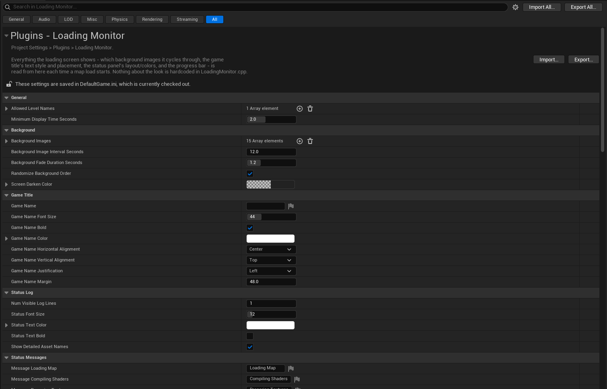
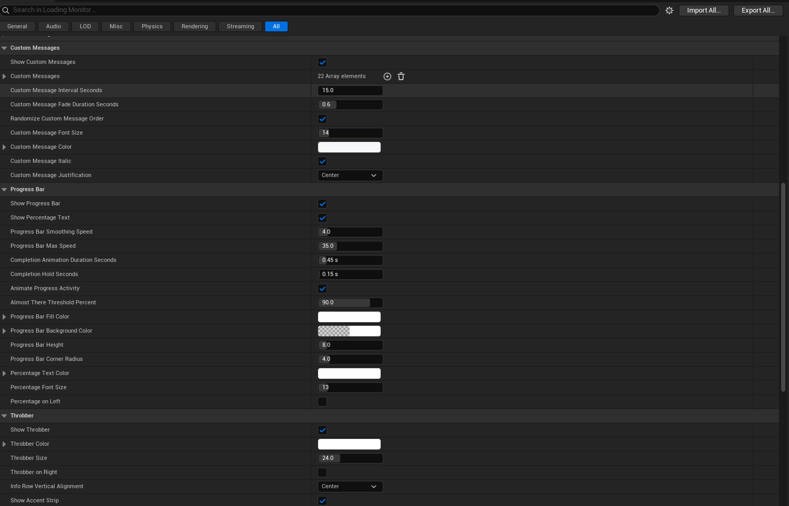
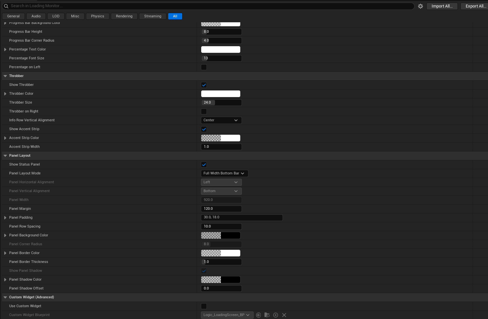

# Loading Monitor

**Smooth loading feedback for Unreal Engine.**

Give map transitions a configurable loading screen with rotating artwork, live engine activity, a smooth progress bar, and your own tips or messages. Loading Monitor uses native Slate and MoviePlayer so the built-in screen can keep animating while the game thread is busy loading a map.

**Unreal Engine 5 · C++ runtime plugin · Version 1.0.3 · Beta**

Created by **Umar Razzaq**. Build-verified on **UE 5.8 / Windows**; other engine versions and platforms require their own validation.

[Features](#features) · [Screenshots](#screenshots) · [Quick start](#quick-start) · [Configuration](#configuration) · [Progress behavior](#progress-behavior) · [Troubleshooting](#troubleshooting) · [Development](#development)

## Features

- **Smooth progress:** frame-driven easing, limited travel speed, and subpixel rendering soften large compilation updates.
- **A visible finish:** the bar reaches 100% after map readiness, then holds briefly before the screen closes.
- **Rotating backgrounds:** texture asset selection, shuffled playback, and crossfades without a dark dip between images.
- **Live status:** readable labels for shaders, textures, meshes, distance fields, Niagara, streaming, and cached data.
- **Two layouts:** a full-width bottom panel or a floating card, with a separate spinner, status text, and percentage.
- **Custom styling:** fonts, colors, spacing, borders, shadows, title placement, and six color presets.
- **Tips and flavor text:** independently rotating messages with their own timing, typography, and alignment.
- **Live preview:** inspect the actual built-in widget with a repeatable simulated load, without triggering map travel.
- **Level filtering:** show the screen for every map or only the levels you choose.

## Screenshots

Project Settings in a configured project. **Click any image to view it at full size.** Values shown here are examples, not necessarily the plugin defaults.

| General, backgrounds & status | Messages & progress | Spinner & panel layout |
| :---: | :---: | :---: |
| [](Docs/Images/settings-general.png) | [](Docs/Images/settings-progress.png) | [](Docs/Images/settings-layout.png) |

## Quick start

1. Close Unreal Editor and copy this plugin into `YourProject/Plugins/LoadingMonitor/`.
2. Generate project files if needed, then build your project’s **Editor** target using a compatible Unreal C++ toolchain.
3. Open the project and confirm **Loading Monitor** is enabled under **Edit → Plugins**.
4. Open **Edit → Project Settings → Plugins → Loading Monitor**.
5. Add textures to **Background Images**, set your title and colors, and choose a **Panel Layout Mode**.
6. Use **Open Live Preview** to inspect the built-in screen, then test a real map transition in **Standalone Game**.

Leave **Allowed Level Names** empty to show the screen on every map load. Add a short name such as `MainMap`, or a full path such as `/Game/Maps/MainMap`, to restrict it. Matching is case-insensitive.

> Settings are read again on the next map load or when a new preview opens. C++ changes require rebuilding the plugin and restarting the editor.

## Configuration

Configuration is stored in `Config/DefaultGame.ini` under `[/Script/LoadingMonitor.LoadingMonitorSettings]`. Use Project Settings for normal editing; the names below also identify the corresponding config properties.

### Backgrounds and title

| Setting | Purpose |
| --- | --- |
| `BackgroundImages` | Select `UTexture2D` assets from the Content Browser. An empty list, or no successfully loaded images, uses the bundled fallback PNG. |
| `BackgroundImageIntervalSeconds` | Time between image changes. Default: **8 s**. |
| `BackgroundFadeDurationSeconds` | Crossfade duration. Default: **1.2 s**; use **0** for a hard cut. Keep it shorter than the image interval. |
| `bRandomizeBackgroundOrder` | Shuffle the background sequence. Enabled by default. |
| `ScreenDarkenColor` | Tint and darken the background to improve text contrast. |
| `GameName` | Display a game title; leave empty to hide it. |
| `GameNameFontSize`, `bGameNameBold`, `GameNameColor` | Title typography and color. |
| `GameNameHorizontalAlignment`, `GameNameVerticalAlignment`, `GameNameJustification`, `GameNameMargin` | Position the title independently of the loading panel. |

### Progress and completion

| Setting | Default | Purpose |
| --- | --- | --- |
| `bShowProgressBar` / `bShowPercentageText` | On / On | Control the bar and percentage independently. |
| `ProgressBarSmoothingSpeed` | **4** | Controls how quickly the displayed value catches up. Higher is more responsive; lower is more gradual. |
| `ProgressBarMaxSpeed` | **35 points/s** | Limits visible travel after large compilation batches. |
| `CompletionAnimationDurationSeconds` | **0.45 s** | Duration of the final ease to 100%; **0** disables that animation. |
| `CompletionHoldSeconds` | **0.15 s** | Keeps the completed bar visible briefly before dismissal. |
| `MinimumDisplayTimeSeconds` | **0.6 s** | Minimum **total** screen time from playback start, in addition to honoring the completion animation and hold. |
| `bAnimateProgressActivity` | On | Adds a subtle forward-moving highlight inside the measured fill. It does not add a bouncing segment. |
| `AlmostThereThresholdPercent` | **90** | Switches to `Message_AlmostThere` when the displayed percentage reaches the threshold. Use **90–95** with the reserved completion range. |
| `ProgressBarHeight` / `ProgressBarCornerRadius` | **8 / 4** | Set the bar thickness and rounding. Full-width layout uses square ends. |
| `PercentageFontSize` | **13** | Percentage text size. |
| `bPercentageOnLeft` | Off | Place the percentage on the left side of its row. |

Use `ProgressBarFillColor`, `ProgressBarBackgroundColor`, and `PercentageTextColor` to match your theme. The smoothing speed affects presentation, not how quickly the map loads.

### Status and custom messages

The status line follows engine activity; custom messages are a separate pool of tips or flavor text.

| Control | Behavior |
| --- | --- |
| `NumVisibleLogLines` | Number of recent status lines to keep. Default: **1**. |
| `StatusFontSize`, `StatusTextColor`, `bStatusTextBold` | Status typography. |
| `bShowDetailedAssetNames` | Append details extracted from engine messages. Off by default; keep it off for a cleaner player-facing screen. Details can contain technical text when a log message has no asset path. |
| `Message_*` labels | Customize the wording for each recognized loading activity. |
| `bShowCustomMessages`, `CustomMessages` | Enable your own rotating message pool. Disabled by default. |
| `CustomMessageIntervalSeconds`, `CustomMessageFadeDurationSeconds` | Message interval and fade duration. Defaults: **3 s / 0.6 s**. |
| `bRandomizeCustomMessageOrder` | Shuffle custom messages. Enabled by default. |
| `CustomMessageFontSize`, `CustomMessageColor`, `bCustomMessageItalic`, `CustomMessageJustification` | Style and align the custom message line. |

<details>
<summary>Recognized activity and configurable labels</summary>

| Activity | Label property |
| --- | --- |
| Map loading | `Message_LoadingMap` |
| Shader compilation | `Message_CompilingShaders` |
| Texture preparation | `Message_PreparingTextures` |
| Static mesh preparation | `Message_PreparingStaticMeshes` |
| Distance field builds | `Message_BuildingDistanceFields` |
| Niagara compilation | `Message_CompilingParticleSystems` |
| World streaming | `Message_StreamingWorldData` |
| Derived Data Cache activity | `Message_FetchingCachedData` |
| Final world setup | `Message_FinishingWorldSetup` |
| Progress threshold reached | `Message_AlmostThere` |

</details>

### Layout, spinner, and presets

| Layout | How it behaves |
| --- | --- |
| **Full Width Bottom Bar** | A bottom panel with a separate spinner/status/percentage row and a thin progress bar below. `PanelPadding.Left` and `.Right` inset the bar; `PanelMargin` controls the gap from the bottom edge. |
| **Floating Card** | A positioned card with configurable width, alignment, corner radius, border, and shadow. `PanelMargin` applies around the card. |

- **Panel:** `PanelLayoutMode`, `PanelPadding`, `PanelRowSpacing`, `PanelBackgroundColor`, `PanelBorderColor`, and `PanelBorderThickness`.
- **Floating card:** `PanelWidth`, horizontal/vertical alignment, `PanelCornerRadius`, and the panel shadow settings.
- **Spinner:** `bShowThrobber`, `ThrobberColor`, `ThrobberSize`, `bThrobberOnRight`, and `InfoRowVerticalAlignment`.
- **Accent:** `bShowAccentStrip`, `AccentStripColor`, and `AccentStripWidth`. The strip appears at the card’s left edge or along the full-width panel’s top edge.
- **Visibility:** turn off `bShowStatusPanel` to display just the background and title.

Choose **Cyan Ops**, **Ember Alert**, **Toxic Signal**, **Violet Core**, **Solar Gold**, or **Signal Red** using the editor preset actions. Presets update the fill, spinner, accent, panel, and status colors while preserving your title and percentage colors.

### Example configuration

A compact starting point for the separate status/spinner layout:

```ini
[/Script/LoadingMonitor.LoadingMonitorSettings]
MinimumDisplayTimeSeconds=0.6
PanelLayoutMode=FullWidthBottomBar
bShowProgressBar=True
bShowPercentageText=True
bShowThrobber=True
bShowDetailedAssetNames=False
ProgressBarSmoothingSpeed=4.0
ProgressBarMaxSpeed=35.0
CompletionAnimationDurationSeconds=0.45
CompletionHoldSeconds=0.15
bAnimateProgressActivity=True
ProgressBarHeight=8.0
```

## Progress behavior

1. **Before measurement:** the track stays empty and the percentage reads `—`. The separate spinner indicates activity. There is no ping-pong or bouncing bar.
2. **During compilation:** cumulative completed work drives an estimate through **0–95%**. New work may pause the climb, but the displayed value never moves backward. The bar and percentage share the same smoothed value.
3. **When the map is ready:** a bounded finish animation takes the bar to **100%**, followed by the configured hold. The minimum total display time is still honored.

> **The percentage is an estimate of asset-compilation work, not an exact percentage of the entire map load.** Actor creation, world setup, and other loading work are not represented by that count. Cached or cooked loads may have no measurable compilation work and remain at `—` until completion.

## Custom Widget mode

Enable `bUseCustomWidget` and assign a Widget Blueprint to `CustomWidgetBlueprint` to replace the built-in screen.

| Built-in Slate screen | Custom Widget Blueprint |
| --- | --- |
| Uses the MoviePlayer loading path. | Uses a normal `AddToViewport()` overlay. |
| Can animate during a blocking game-thread load. | Freezes while the game thread is blocked. |
| Uses the plugin’s styling, progress, and completion timing. | Uses your widget’s own design; built-in styling and timing do not apply. |
| Preview includes simulated loading activity. | Preview shows the widget without a simulated progress feed. |

UMG/Blueprint widgets are kept off MoviePlayer’s loading thread. The custom overlay is removed when the map finishes loading.

## Troubleshooting

| Symptom | Check |
| --- | --- |
| The screen does not appear. | Confirm the plugin is enabled, the destination matches `AllowedLevelNames`, and MoviePlayer is available. Test map travel in Standalone Game. |
| The UI freezes in editor-embedded PIE. | Use Standalone Game or a packaged build to evaluate blocking-load animation. Use Live Preview to inspect styling. |
| The bar stays empty or displays `—`. | No asset-compilation progress has been measured yet. This can be normal on cached/cooked loads. |
| Progress pauses below 100%. | Compilation samples can arrive in batches, and additional work can be discovered. The last 5% is reserved for map readiness. |
| Status text is too technical or changes too often. | Disable `bShowDetailedAssetNames` and use one visible log line. |
| Background artwork is missing. | Confirm the texture references resolve and the assets are included in your packaged build. Empty or failed image lists use the bundled fallback. |
| Layout controls are disabled. | Check Custom Widget mode. Card-only controls are also disabled in Full Width Bottom Bar mode. |
| Building reports that the plugin DLL cannot be opened. | Save your work and close Unreal Editor, then rebuild. The running editor may hold the DLL open. |

The built-in screen cannot keep animating through a render-thread, RHI, GPU, driver, or whole-process stall. Test packaged behavior on the target hardware.

## Development

### Source map

| File | Responsibility |
| --- | --- |
| [LoadingMonitor.cpp](Source/LoadingMonitor/Private/LoadingMonitor.cpp) | Thread-safe activity capture, Slate layout, map-load lifecycle, and preview session. |
| [LoadingMonitorProgress.h](Source/LoadingMonitor/Private/LoadingMonitorProgress.h) | Engine-independent progress presentation and completion model. |
| [LoadingMonitorSettings.h](Source/LoadingMonitor/Public/LoadingMonitorSettings.h) | Project Settings properties and defaults. |
| [LoadingMonitorSettings.cpp](Source/LoadingMonitor/Private/LoadingMonitorSettings.cpp) | Default messages and editor color presets. |
| [LoadingMonitor.Build.cs](Source/LoadingMonitor/LoadingMonitor.Build.cs) | Module dependencies and fallback-image staging. |
| [LoadingMonitorProgressTests.cpp](Tests/LoadingMonitorProgressTests.cpp) | Standalone timing and progress regression checks. |

The loading widget consumes a plain settings snapshot and mutex-protected loading state. Progress is advanced once per widget tick; reading the percentage does not advance the animation.

### Run the progress checks

From a Visual Studio **x64 developer command prompt**, run in this plugin’s folder:

```bat
cl /nologo /EHsc /std:c++17 Tests\LoadingMonitorProgressTests.cpp /Fe:"%TEMP%\LoadingMonitorProgressTests.exe" /Fo:"%TEMP%\LoadingMonitorProgressTests.obj"
"%TEMP%\LoadingMonitorProgressTests.exe"
```

The checks cover unknown progress, first-sample behavior, burst limits, render hitches, newly discovered work, completion, repeated completion callbacks, cached loads, reset, invalid counts, and **30 / 60 / 144 FPS**.

### Visual verification

- Open **Live Preview** and inspect both panel layouts. Its 15-second cycle includes unknown progress, bursts, new work, a pause, and completion.
- Test cold and cached map transitions in **Standalone Game**, including a load that exceeds the minimum screen time.
- Confirm the bar reaches 100% before dismissal; also test with the status panel hidden.
- Validate artwork, text readability, and transitions in a packaged build on the target hardware.

Build and model-test results do not replace visual testing of a real map transition.
